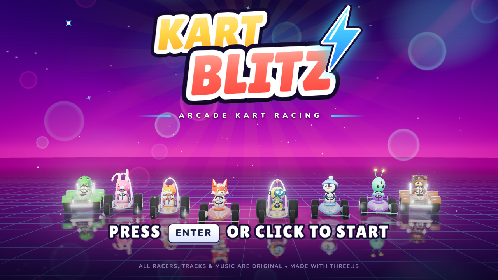
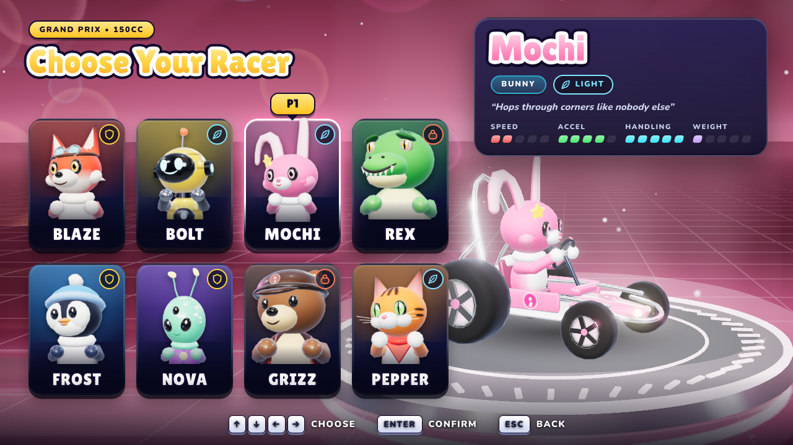
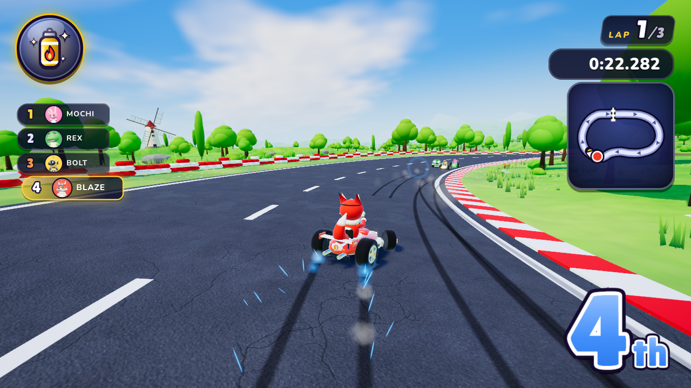
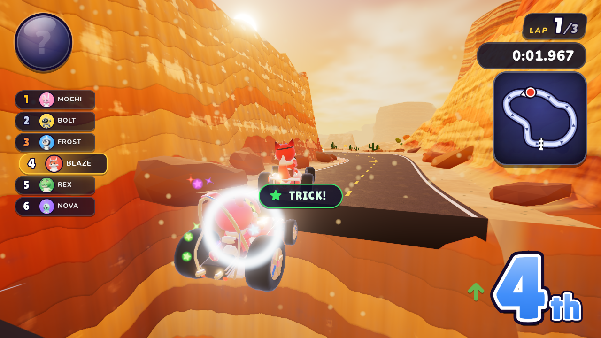
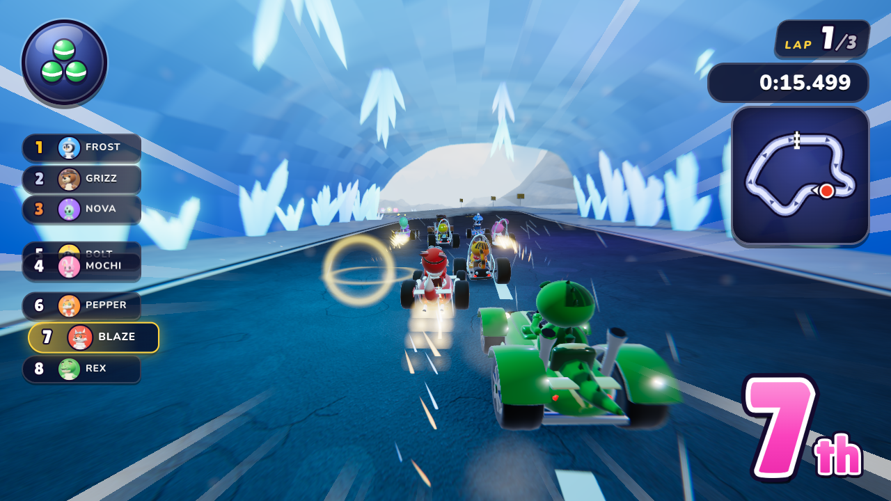
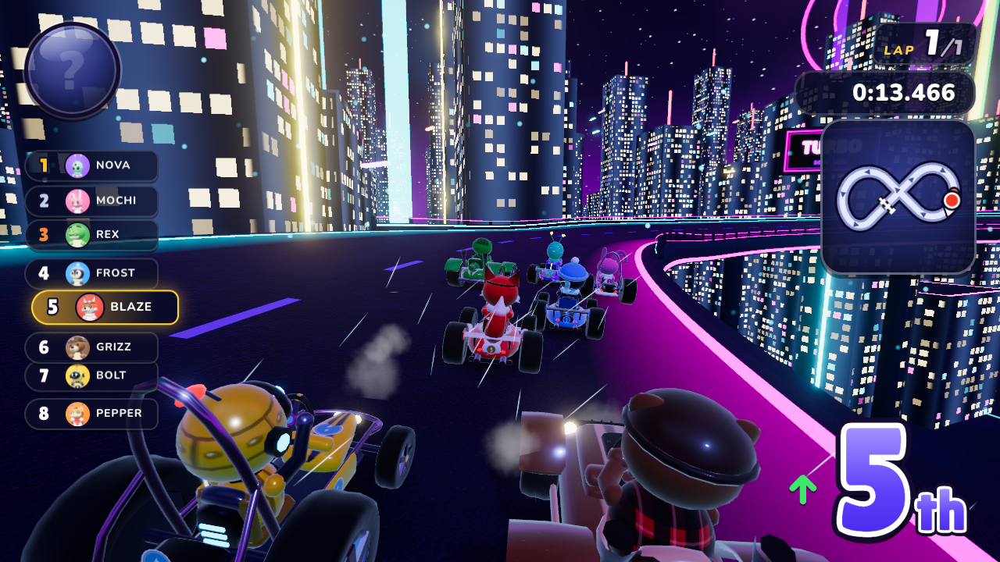
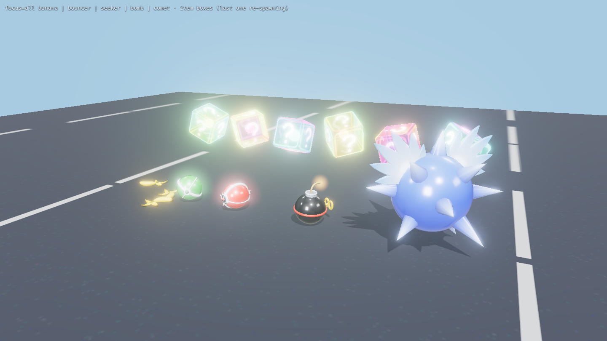
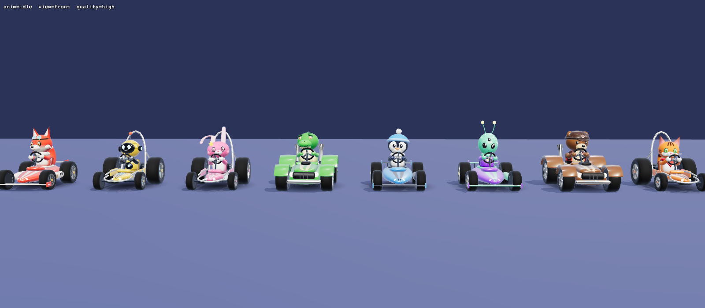
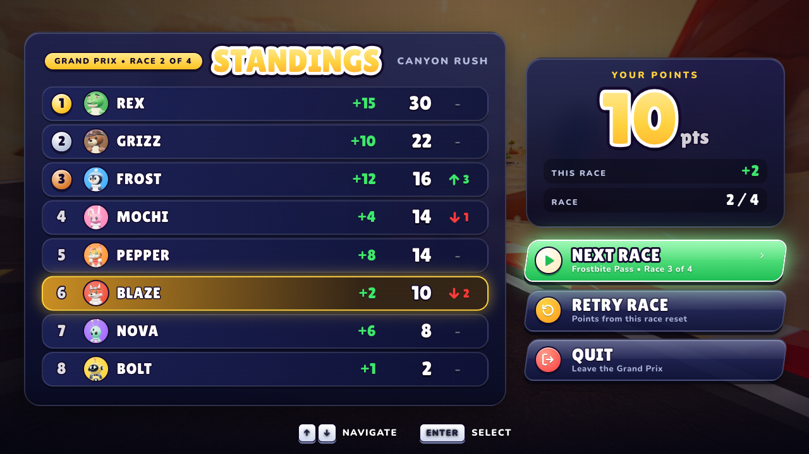
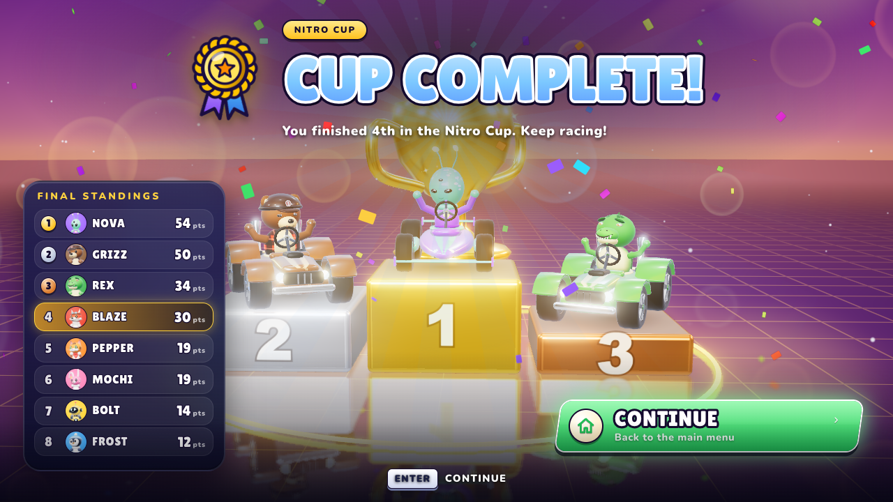

# KART BLITZ

An arcade kart racer in the spirit of Mario Kart 8, built with **Three.js r186**. It runs in the browser at 60 fps.
Every model, texture, song and sound effect is generated procedurally in code. The repo contains no downloaded
art or audio assets.

8 original racers · 4 themed tracks · 13 items · Grand Prix, Quick Race and Time Trial · 50/100/150/200cc
· keyboard + gamepad

| | |
|---|---|
|  |  |
|  |  |
|  |  |
|  |  |
|  |  |

## Quick start

```bash
npm install
npm run dev          # open the printed URL (http://localhost:5173)
npm run build        # production bundle in dist/ (static; base './' so it runs from any folder)
npm run preview      # serve dist/
```

Click the page once (or press a key) to enable sound. Browsers require a user gesture before audio can start.

## Controls

| Action | Keyboard | Gamepad |
|---|---|---|
| Accelerate | W / ↑ | A |
| Brake / reverse | S / ↓ | B / LT |
| Steer | A D / ← → | Left stick / D-pad |
| Hop / drift | Space or Shift (hold while steering) | RB / RT |
| Use item (hold to trail it behind you as a shield) | E / K / Ctrl | LB / X |
| Throw item backward | Hold S / ↓ or Q while using | Hold B / LT or Y while using |
| Look back | Q / C | Y |
| Pause | Esc / P | Start |
| Menus | Arrows + Enter, Esc/Backspace = back, mouse | D-pad/stick + A, B = back |

### Split-screen (2–4 players)

Quick Race and Grand Prix support up to **4 local players** (Time Trial is solo). Pick the number of players in the
menu; each player joins with their own device and picks a racer. CPUs fill the grid up to 8 karts.
2P = top/bottom halves, 3P = 2x2 with a shared overview/minimap panel in the free quadrant, 4P = 2x2.

| | Keyboard 1 (left half) | Keyboard 2 (right half) | Gamepads |
|---|---|---|---|
| Accelerate / brake | W / S | ↑ / ↓ | A / B |
| Steer | A / D | ← / → | Left stick / D-pad |
| Hop / drift | Space or Left Shift | Right Shift or . | RB / RT |
| Use item | E or Left Ctrl | / or Right Ctrl or Enter | LB / X |
| Look back | Q | , | Y |

Up to four gamepads can be used at once (one per player). Esc / P / Start pauses for everyone.
Debug URL: `/?quick=1&players=3&pchars=blaze,bolt,mochi&pdev=kb1,kb2,pad0&skipintro=1`. See `docs/SPLITSCREEN.md`.

### Driving tips
* **Drift:** hold drift while steering into a corner. Sparks go **blue → orange → purple** as the drift charges.
  Release for a mini-turbo. Steer *into* the turn to charge faster.
* **Rocket start:** press accelerate just after the **2** of the countdown. Press too early and you'll stall.
* **Tricks:** tap drift as you leave a ramp or crest for a landing boost.
* **Slipstream:** tuck in behind a rival at speed to charge a draft boost.
* Boost pads, nitros and stars let you cut across grass without slowing down.

## Game content

* **Racers** (stats: speed / accel / handling / weight):
  * **Light:** Bolt the robot, Mochi the bunny, Pepper the cat
  * **Medium:** Blaze the fox, Frost the penguin, Nova the alien
  * **Heavy:** Rex the dino, Grizz the bear
* **Nitro Cup (4 tracks, about 1.1–1.4 km per lap):**
  * **Sunshine Circuit:** rolling hills, flower meadows, a lake you can fall into, windmills, hot-air balloons,
    a grandstand crowd, a crest jump and a grass shortcut.
  * **Canyon Rush:** golden-hour mesas with layered strata, banked canyon turns, cacti and tumbleweeds, a rock
    arch, and a 17 m ramp jump over a chasm.
  * **Frostbite Pass:** snowy peaks and pines, falling snow, a frozen lake with slippery ice, a glowing crystal
    ice cave, and a downhill jump.
  * **Neon Skyway:** an elevated figure-8 through a midnight skyline, with a real over/under crossover, rail-less
    edges you can fall off, a gap jump and bloom-heavy neon.
* **Items:**
  * **Nitro, Triple Nitro, Golden Nitro:** speed boosts
  * **Banana, Triple Banana:** hazards dropped behind you
  * **Bouncer, Triple Bouncer:** ricochet orbs
  * **Seeker, Triple Seeker:** homing orbs
  * **Bomb:** thrown explosive
  * **Super Star:** invincibility
  * **Thunderbolt:** shrinks every rival
  * **Comet:** hunts the race leader

  Distribution is position-weighted, so leaders get defensive items and the back of the pack gets comeback
  items.
* **Modes:**
  * **Grand Prix:** 4 races with points and a podium ceremony
  * **Quick Race:** any track against 7 CPUs
  * **Time Trial:** solo with 3 nitros; best times are saved locally

## Project layout

The project was built by five parallel agents working against a shared contract. Their areas map onto the
folders below. See [`ARCHITECTURE.md`](ARCHITECTURE.md) for every module API, convention and event.

| Folder | Contents |
|---|---|
| `src/Game.js`, `src/race/`, `src/core/`, `src/data/` | game loop, state machine, race rules (laps/places/GP points/records), events, shared data |
| `src/kart/`, `src/input/`, `src/camera/` | arcade kart physics (drift, mini-turbo, rocket start, tricks, slipstream, collisions, respawn), input, camera |
| `src/track/` | spline track generator, the 4 tracks, terrain, sky, lighting, decoration, track query API |
| `src/visuals/`, `src/fx/` | procedural characters & karts, animation, portraits, particles, post-processing, menu showroom |
| `src/items/`, `src/ai/` | item boxes, 13 items, projectiles, CPU racers (racing lines, drifting, item tactics) |
| `src/ui/`, `src/audio/` | all menus, HUD, results & trophy screens; WebAudio music sequencer, SFX and engines |
| `dev/<area>/` | per-area dev/test pages (track viewer, kart lineup, FX lab, item gallery, audio jukebox …) |
| `scripts/` | `snap.mjs` (headless screenshot harness), `smoke.mjs` (end-to-end suite) |

## Testing & debugging

```bash
npm run check                    # bundle/import check (esbuild)
npm run smoke                    # end-to-end suite: every track to results, GP, time trial, pause, leaks, fps
npm run smoke -- --dist          # same, against the production bundle
node scripts/snap.mjs "/?quick=1&track=neon&skipintro=1&autodrive=1" --wait=6000 --out=snaps/neon.png
```

URL parameters for quick testing: `quick=1` (skip menus), `mode=quick|gp|timetrial`,
`track=meadow|canyon|glacier|neon`, `char=blaze|bolt|mochi|rex|frost|nova|grizz|pepper`, `cc=50|100|150|200`,
`laps=N`, `ai=0..7`, `autodrive=1` (the CPU drives your kart), `skipintro=1`, `nocountdown=1`,
`players=1..4`, `pchars=a,b,..`, `pdev=kb1,kb2,pad0,..` (split-screen), `debug=1` (fps/draw calls/kart state), `mute=1`, `quality=low|medium|high|mobile`, `timescale=0.05..8`, `mobile=1|0` (force / disable the phone experience).
The live game instance is `window.__game`.

## Tech notes

* Three.js r186 WebGL renderer uses ACES tone mapping and PCF shadows. Post-processing runs HDR + MSAA, then
  bloom, then a speed-blur/grade pass, then OutputPass.
* Arcade physics runs in "track space" against an analytic spline query: banked roads, walls, jump gaps and
  over/under-passes. It sub-steps for frame-rate independence.
* Audio is 100% WebAudio synthesis: a lookahead step sequencer with 8 original songs, about 50 SFX, and
  per-kart engine voices with spatial panning.
* Measured on an Apple M5 Pro: every track holds 60 fps with 8 karts, at about 175–235 draw calls and 0.3–0.8 M
  triangles per frame. At native Retina resolution (3024×1964) a full frame costs about 8 ms, which is
  roughly 125 fps of headroom for 120 Hz displays.
* Dynamic resolution: if frames stay slow on weaker GPUs, the renderer steps its pixel ratio down in 0.25
  increments, and climbs back up when there is headroom. Options → Quality (low/medium/high) sets the ceiling.

## Mobile (phones & tablets)

Kart Blitz runs on phones in landscape (single player: Grand Prix, Quick Race, Time Trial) with on-screen touch
controls, a phone-sized HUD, a mobile quality preset with dynamic resolution (down to 0.75x) and a "rotate your
phone" prompt in portrait. Add it to the home screen (iOS: Share → Add to Home Screen; Android: Install app) for a
fullscreen, landscape experience. The mobile plan and team contract live in `docs/MOBILE.md`; architecture notes in
`ARCHITECTURE.md` §14.

```bash
# emulate a phone (real Chrome: touch, DPR, mobile UA, landscape; appends mobile=1)
node scripts/snap.mjs "/" --mobile --wait=3000 --out=snaps/mobile/title.png            # iphone 844x390@3 (default)
node scripts/snap.mjs "/?quick=1&skipintro=1&mute=1" --mobile=se \
  --actions="multitouch:110,280,2500|740,300,2500;shot:snaps/mobile/race.png"          # se | pixel | ipad too
node scripts/snap.mjs "/?quick=1&autodrive=1&debug=1" --mobile --fps --actions="cpu:4;wait:8000"
npm run smoke -- --only=mobile,perf:mobile                                             # phone scenarios
node scripts/make-icons.mjs                                                            # regenerate PWA icons in public/
```

Touch actions: `tap:x,y`, `touch:x,y,ms`, `drag:x1,y1,x2,y2,ms`, `multitouch:x,y,ms|x,y,ms`, `rotate:portrait|landscape`,
`cpu:4` (see the header of `scripts/snap.mjs`). On a real device, deploy (GitHub Pages) or `npm run dev` and open the
LAN URL; on iOS audio is muted by the silent switch unless the page sets the playback audio session.
